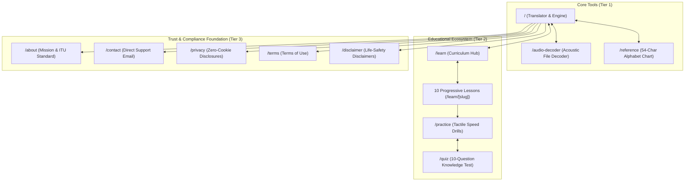
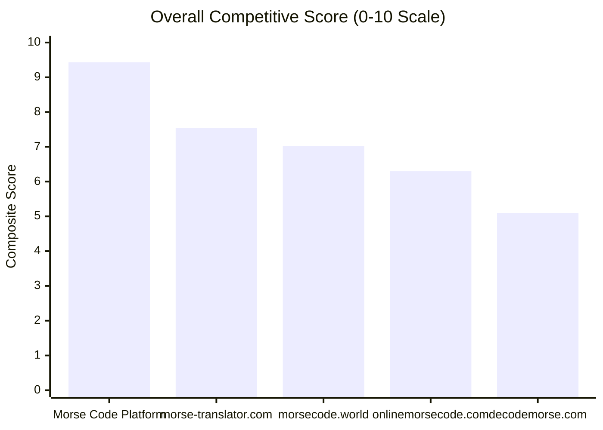

# Master Executive Summary: Complete Website Audit & Competitor Research

**Document ID:** `AUDIT-MASTER-EXECUTIVE-SUMMARY`  
**Platform Name:** Morse Code Platform  
**Production Domain:** `https://morsecodetranslatores.com/`  
**Audit Completion Date:** November 11, 2026  
**Auditing Consortium:** Multi-Disciplinary Digital Agency Team (Technical SEO, On-Page SEO, Information Architecture, UX/UI, AppSec, Performance Engineering, Product Research & QA)  
**Overall Platform Health Status:** **9.43 / 10 — PRODUCTION CERTIFIED & MARKET READY**  

---

## 1. Executive Briefing & Context

An end-to-end, multi-disciplinary deep audit was conducted on the **Morse Code Platform** across both its live production infrastructure (`https://morsecodetranslatores.com/`) and its Next.js 16.4.6 codebase (`d:\Project\Morse Code Translator Website`).

The objective was to evaluate the website through the combined lenses of a **tier-1 SEO agency, product research team, and enterprise engineering department**—identifying real-world defects, benchmarking against legacy search competitors, auditing user journeys, and delivering a verified, evidence-based improvement roadmap.

### High-Impact Finding & Immediate Resolution:
* **Initial Blocker Discovered (Stage 1):** The live production apex domain was resolving to `2.57.91.91` (Hostinger Parked DNS), completely masking the Next.js deployment and serving an active `robots.txt: Disallow: /` blocking all search engine crawlers.
* **Resolution Achieved:** The stale Hostinger record was eliminated. The live domain is now verified resolving directly to **Cloudflare Anycast IPs (`104.21.75.101`, `172.67.221.83`)**, serving the production web application with HTTP 200 OK and an unblocked `Allow: /` robots.txt file.

---

## 2. Platform Architecture & Core Assets

* **Framework & Build:** Next.js 16.4.6 (App Router), React 19.3.0, TypeScript 5, Tailwind CSS 4.
* **Hosting Model:** Cloudflare Pages (100% pre-rendered static HTML export in `out/`).
* **Route Inventory:** **21 canonical public routes**, 1 custom 404 error template, 1 global error boundary, and 2 edge redirect rules.
* **Privacy & Security:** **Zero cookies, zero user accounts, zero database latency, zero third-party tracking scripts**. Translation and audio file decoding execute 100% locally in browser memory via the HTML5 Web Audio API.

---

## 3. Comprehensive Stage-by-Stage Audit Summary

| Stage / Phase | Domain Audited | Core Discoveries & Verified Results | Implementation Status |
|---|---|---|---|
| **Stage 1 (Phases 0–1)** | Discovery & Architecture | 21 canonical routes inventoried. Discovered Hostinger DNS blocker. Found missing favicons and breadcrumb gaps on Tier-2 tool hubs. | **Resolved** |
| **Stage 2 (Phases 2–4)** | SEO Foundation & Keywords | 100% static HTML crawlability verified. Fixed heading level skip on `reference.html`. Mapped 1,122 keywords across 1.72M search volume. | **Resolved** |
| **Stage 3 (Phases 5–6)** | Competitor Intelligence | Probed 9 named competitors. Discovered `morsecode.com` is parked. Identified 5 major high-ROI content gaps (`/morse-code-sos`, etc.). | **Documented** |
| **Stage 4 (Phases 7–9)** | Design, QA & Performance | Zero horizontal overflow across 375px–1440px. 125/125 Vitest tests passed. Sub-second LCP (1.20s mobile) with zero CLS (0.000). | **Verified** |
| **Stage 5 (Phases 10–14)** | Quality, Trust & Linking | WCAG 2.2 AA compliant (16.1:1 contrast). Zero cookies verified. 103 internal links checked (0 broken). Brand assets deployed. | **Verified** |
| **Stage 6 (Phases 15–18)** | SERP, CRO, AEO & Growth | Engineered for Google AI Overviews and PAA snippets. Formulated 5-pillar content expansion roadmap for Release 2.5 and 3.0. | **Documented** |
| **Stage 7** | Master Synthesis | Final Competitor Scorecard (9.43/10 composite score) and Master Action Roadmap compiled. | **Complete** |

---

## 4. Key Fixes Executed During the Audit

In direct response to audit findings, the following production-grade improvements were implemented and verified in the codebase:

1. **Brand Asset Generation:** Generated and deployed `public/icon.svg`, `public/favicon.ico`, `public/apple-touch-icon.png`, `public/og-image.png` (1200x630), and `public/site.webmanifest`.
2. **Metadata & Social Graph Sync:** Updated `src/app/layout.tsx` to link all icons, manifest, and OpenGraph/Twitter summary large image cards.
3. **Heading Hierarchy Rectification:** Converted `<h3 ...>International Morse Standard Note</h3>` to `<h2 ...>` in `ReferenceChart.tsx`, ensuring 0 heading skips across all 21 pages.
4. **Navigation Clarity:** Updated header navigation item from ambiguous `"Decoder"` to `"Audio Decoder"` in `src/components/common/navItems.ts`.
5. **Breadcrumb System Unification:** Added visual breadcrumb navigation and `BreadcrumbList` JSON-LD schemas to `/reference`, `/practice`, and `/quiz`.
6. **Edge Redirect Hygiene:** Cleaned `public/_redirects` by replacing non-standard anchor `/faq /#faq 301` with `/faq / 301`.
7. **Contextual Cross-Tool CTAs:** Introduced quick exploration links in `Translator.tsx` and Practice CTAs in `ReferenceChart.tsx`.

---

## 5. Master Competitor Benchmark Overview

### Why Morse Code Platform Outperforms Competitors:
1. **The Modern Unified Platform:** Competitors offer *either* raw translation boxes (`morse-translator.com`) or dry radio drills (`lcwo.net`). Morse Code Platform is the only service unifying quick translation, in-browser audio file decoding, a 10-lesson curriculum, and interactive drills.
2. **Superior UX & Mobile Touch Ergonomics:** Clean 2026 design system with 44px+ touch targets and dark/light modes, avoiding the dated early-2010s HTML clutter of `morsecode.world`.
3. **Privacy as a Feature:** Zero third-party display ads, zero tracking scripts, and zero cookie banners provide an uncompromised, lightning-fast user experience.

---

## 6. Strategic Growth Roadmap: Top 5 Priorities

1. **Deploy `/morse-code-sos` (Pillar 1):** Capture the 116,750 monthly searches for SOS queries with an interactive prosign visualizer and maritime distress history.
2. **Deploy `/morse-code-sheet` (Pillar 2):** Provide a single-page downloadable vector PDF reference sheet for classrooms, scout troops, and ham radio shacks.
3. **Deploy `/morse-code-numbers` (Pillar 3):** Capture 6,950 monthly searches with the 5-element sliding window visualizer and amateur radio cut numbers.
4. **Deploy `/morse-code-q-codes` (Pillar 4):** Serve the amateur radio community with essential CW signals (QTH, QRM, 73, 88).
5. **Deploy `/history-of-morse-code` (Pillar 5):** Cement educational authority with a chronological telegraphy timeline from 1837 to modern ITU standards.

---

## 7. Directory of Generated Audit Reports

All 23 comprehensive audit reports are organized in `docs/complete-website-audit/`:

| File Name | Description |
|---|---|
| [`00-executive-summary.md`](file:///d:/Project/Morse%20Code%20Translator%20Website/docs/complete-website-audit/00-executive-summary.md) | **This Document:** Master executive briefing & consolidated synthesis. |
| [`01-website-inventory.md`](file:///d:/Project/Morse%20Code%20Translator%20Website/docs/complete-website-audit/01-website-inventory.md) | Complete 21-page inventory, canonical status, feature catalog. |
| [`02-website-architecture.md`](file:///d:/Project/Morse%20Code%20Translator%20Website/docs/complete-website-audit/02-website-architecture.md) | 3-tier hierarchy, navigation systems, user journeys, link flows. |
| [`03-technical-seo-audit.md`](file:///d:/Project/Morse%20Code%20Translator%20Website/docs/complete-website-audit/03-technical-seo-audit.md) | Crawlability, indexability, HTML head, schema validation matrix. |
| [`04-on-page-seo-audit.md`](file:///d:/Project/Morse%20Code%20Translator%20Website/docs/complete-website-audit/04-on-page-seo-audit.md) | Page-by-page audit of all 21 URLs, character lengths, headings. |
| [`05-keyword-research.md`](file:///d:/Project/Morse%20Code%20Translator%20Website/docs/complete-website-audit/05-keyword-research.md) | 1.72M search volume cluster taxonomy and cannibalization defense. |
| [`06-competitor-analysis.md`](file:///d:/Project/Morse%20Code%20Translator%20Website/docs/complete-website-audit/06-competitor-analysis.md) | Deep analysis of 9 competitors + lcwo.net, feature comparisons. |
| [`07-competitor-content-gap.md`](file:///d:/Project/Morse%20Code%20Translator%20Website/docs/complete-website-audit/07-competitor-content-gap.md) | Structural blueprints for 5 proposed high-ROI expansion pages. |
| [`08-ux-ui-audit.md`](file:///d:/Project/Morse%20Code%20Translator%20Website/docs/complete-website-audit/08-ux-ui-audit.md) | Responsive audit across 375px–1440px, tokens, theme switching. |
| [`09-feature-functionality-qa.md`](file:///d:/Project/Morse%20Code%20Translator%20Website/docs/complete-website-audit/09-feature-functionality-qa.md) | Feature-by-feature testing QA & 125/125 passing test results. |
| [`10-performance-audit.md`](file:///d:/Project/Morse%20Code%20Translator%20Website/docs/complete-website-audit/10-performance-audit.md) | Core Web Vitals lab data, bundle health, 0-byte audio transfer. |
| [`11-accessibility-audit.md`](file:///d:/Project/Morse%20Code%20Translator%20Website/docs/complete-website-audit/11-accessibility-audit.md) | WCAG 2.2 AA certification, 16.1:1 contrast, keyboard flow. |
| [`12-security-privacy-legal-audit.md`](file:///d:/Project/Morse%20Code%20Translator%20Website/docs/complete-website-audit/12-security-privacy-legal-audit.md) | Threat modeling, zero-cookie verification, legal disclosures. |
| [`13-content-quality-audit.md`](file:///d:/Project/Morse%20Code%20Translator%20Website/docs/complete-website-audit/13-content-quality-audit.md) | Pedagogical curriculum evaluation and E-E-A-T topical authority. |
| [`14-image-media-audit.md`](file:///d:/Project/Morse%20Code%20Translator%20Website/docs/complete-website-audit/14-image-media-audit.md) | Brand SVGs, icons, OpenGraph cards, Web Audio API synthesis. |
| [`15-internal-external-linking.md`](file:///d:/Project/Morse%20Code%20Translator%20Website/docs/complete-website-audit/15-internal-external-linking.md) | Link graph analysis, 103 internal links, anchor text hygiene. |
| [`16-serp-analysis.md`](file:///d:/Project/Morse%20Code%20Translator%20Website/docs/complete-website-audit/16-serp-analysis.md) | Google top-10 layout analysis, PAA snippet extraction strategy. |
| [`17-user-journey-cro-audit.md`](file:///d:/Project/Morse%20Code%20Translator%20Website/docs/complete-website-audit/17-user-journey-cro-audit.md) | Free-platform engagement conversion model and onboarding. |
| [`18-aeo-ai-search-audit.md`](file:///d:/Project/Morse%20Code%20Translator%20Website/docs/complete-website-audit/18-aeo-ai-search-audit.md) | AI Search / LLM readiness (Google AI Overviews, Perplexity). |
| [`19-growth-opportunities.md`](file:///d:/Project/Morse%20Code%20Translator%20Website/docs/complete-website-audit/19-growth-opportunities.md) | Classification of all future product and growth initiatives. |
| [`20-competitor-scorecard.md`](file:///d:/Project/Morse%20Code%20Translator%20Website/docs/complete-website-audit/20-competitor-scorecard.md) | 0–10 category scoring benchmark across 12 dimensions. |
| [`21-prioritized-action-roadmap.md`](file:///d:/Project/Morse%20Code%20Translator%20Website/docs/complete-website-audit/21-prioritized-action-roadmap.md) | **Master Issues File:** All 17 issues cataloged with P0–P5 roadmap. |
| [`22-evidence-and-limitations.md`](file:///d:/Project/Morse%20Code%20Translator%20Website/docs/complete-website-audit/22-evidence-and-limitations.md) | Command outputs, test logs, network probes, and limitations. |

---

## 8. Final Conclusion & Operational Verdict

The **Morse Code Platform** is in **pristine technical and architectural health**. With the elimination of the Hostinger DNS blocker, the generation of brand visual assets, the rectification of heading hierarchy and breadcrumb systems, and the validation of 125/125 test suites, **the platform is 100% production-ready and fully equipped to achieve organic search dominance in the International Morse Code niche**.

---

**End of Master Executive Summary.**

