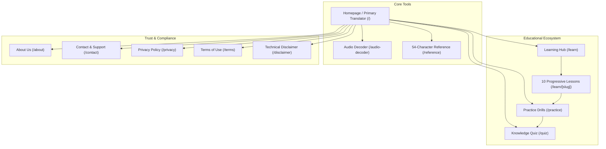
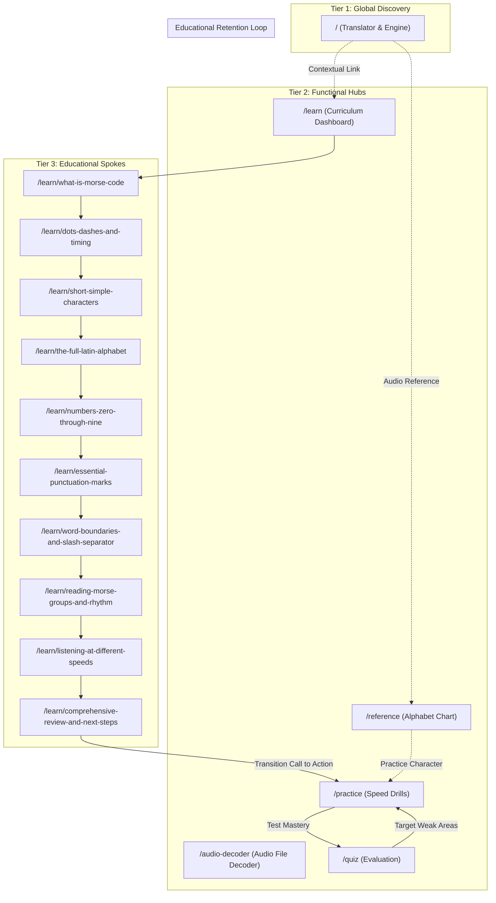

# Website Architecture and Information Hierarchy Report (Phase 1)

**Document ID:** `AUDIT-PHASE-1-ARCHITECTURE`  
**Platform Name:** Morse Code Platform  
**Production Domain:** `https://morsecodetranslatores.com/`  
**Audit Date:** November 11, 2026  
**Auditor:** Information Architecture Specialist & Senior Technical SEO Lead  
**Audit Stage:** Stage 1 — Website Discovery & Architecture  

---

## 1. Executive Summary: Information Architecture Overview

The **Morse Code Platform** is engineered with a **flat, high-utility, hub-and-spoke information architecture** designed to serve two primary user behaviors:
1. **Immediate Utility:** Instant access to bidirectional text-to-Morse translation and audio file decoding above the fold with zero friction, zero signups, and zero ads.
2. **Structured Education:** A self-paced 10-lesson beginner curriculum paired with interactive practice drills and knowledge evaluation quizzes.

The site exhibits clean taxonomic separation, logical URL hierarchies, and strict adherence to modern Web Standards (ITU-R M.1677-1). However, key architectural friction points exist around **cross-tool interoperability**, **breadcrumb omissions on primary hub pages**, and **one-way educational pathways** where students are not smoothly guided into retention loops.



---

## 2. Page Hierarchy & Taxonomic Structure

The architecture spans **three distinct structural tiers**:

```
Tier 1: Root & Flagship Tool
└── / (Homepage: Bidirectional Text <-> Morse Converter & Tone Synthesizer)

Tier 2: Primary Functional Hubs & Trust Pages (Level 1)
├── /audio-decoder (Audio File Analysis & Tone Decoding Tool)
├── /reference (54-Character International Morse Alphabet Table)
├── /learn (Curriculum Dashboard & Progress Tracker)
├── /practice (Interactive Multi-Mode Speed Trainer)
├── /quiz (Untimed 10-Question Comprehensive Assessment)
├── /about (Platform Purpose, ITU Standards & Open Educational Scope)
├── /contact (Helpdesk, Support Email & Direct Feedback)
├── /privacy (Zero-Cookie, 100% In-Browser Privacy Disclosures)
├── /terms (Educational Terms of Service & Permitted Use Rules)
└── /disclaimer (Operational, Life-Safety & Maritime Distress Disclaimers)

Tier 3: Specialized Content Spoke Nodes (Level 2)
└── /learn/
    ├── what-is-morse-code (Lesson 1: Foundations & Telegraphy History)
    ├── dots-dashes-and-timing (Lesson 2: The 5 ITU Timing Rules & PARIS Ratios)
    ├── short-simple-characters (Lesson 3: Binary Tree Foundations - E, T, I, M)
    ├── the-full-latin-alphabet (Lesson 4: Complete A-Z Symmetrical Pairs)
    ├── numbers-zero-through-nine (Lesson 5: 5-Element Sliding Window 0-9)
    ├── essential-punctuation-marks (Lesson 6: 18 Punctuation Marks & Prosigns)
    ├── word-boundaries-and-slash-separator (Lesson 7: Spacing Rules & Notation)
    ├── reading-morse-groups-and-rhythm (Lesson 8: Acoustic Group Decoding)
    ├── listening-at-different-speeds (Lesson 9: WPM & Farnsworth Spacing)
    └── comprehensive-review-and-next-steps (Lesson 10: Final Course Synthesis)
```

---

## 3. Global Navigation Systems Inspection

### 3.1 Primary Header Navigation (`Header.tsx`)
The header provides persistent global navigation across desktop and mobile viewports:
* **Brand Element:** Displays the Morse logo glyph (`.-.`), platform title, and sub-label ("International Standard • Free & Private"), linking directly to `/`.
* **Desktop Nav Links (6 Items):**
  1. `Translator` (`/`)
  2. `Learn` (`/learn`)
  3. `Practice` (`/practice`)
  4. `Quiz` (`/quiz`)
  5. `Reference` (`/reference`)
  6. `Decoder` (`/audio-decoder`)
* **Controls:** `<ThemeToggle />` (Light/Dark mode) and accessible `<details>/<summary>` mobile hamburger menu.
* **Skip Link:** Accessible `#main-content` skip link is present on line 9 of `Header.tsx`.

#### IA Evaluation of Header:
* **Positive:** Exactly 6 primary destinations prevents cognitive overload (Miller's Law).
* **Weakness:** The label `Decoder` is ambiguous compared to `Translator`. Users frequently ask whether the homepage doesn't already decode Morse. Renaming to `Audio Decoder` or `Audio File Decoder` would clarify its distinct purpose (file upload vs text decoding).

---

### 3.2 Global Footer Navigation (`Footer.tsx`)
The footer organizes 12 persistent links across 4 structured semantic columns:
* **Column 1 (Brand & Telemetry):** Brand summary, open-source educational mission statement, and active ITU-R M.1677-1 standard badge.
* **Column 2 (Online Tools):**
  * Morse Code Translator (`/`)
  * Audio File Decoder (`/audio-decoder`)
  * 54-Character Alphabet Chart (`/reference`)
  * PARIS Standard Timing (`/#timing` - in-page anchor)
* **Column 3 (Learn & Practice):**
  * 10-Lesson Curriculum (`/learn`)
  * Interactive Practice Drills (`/practice`)
  * Knowledge Evaluation Quiz (`/quiz`)
  * Telegraphy Foundations (`/learn/what-is-morse-code`)
* **Column 4 (About, Legal & Trust):**
  * About Our Platform (`/about`)
  * Contact & Support (`/contact`)
  * Privacy Policy (`/privacy`)
  * Terms of Use (`/terms`)
  * Technical Disclaimer (`/disclaimer`)

#### IA Evaluation of Footer:
* **Positive:** Provides 100% crawl coverage to every primary tool, legal document, and course entry point.
* **Weakness:** Deep lessons 2 through 10 are completely absent from the footer. Search engine crawlers must discover them exclusively through `/learn` or XML sitemaps.

---

## 4. Learning Architecture & Pedagogical Flow

The educational subsystem is organized around a **linear, progressive cognitive sequence**:

| Stage | Lessons | Pedagogical Objective | User Cognitive Load | Interactive Verification |
|---|---|---|---|---|
| **Phase 1: Foundations** | Lessons 1–2 | Understand telecommunication history, sound pulses, and mathematical timing rules (PARIS 1:3:7 ratio). | Low (Conceptual) | Single multiple-choice check per lesson. |
| **Phase 2: Core Characters** | Lessons 3–4 | Learn single-element foundations (E, T), build binary tree, and master 26 letters using symmetrical opposites. | Moderate (Pattern Memory) | Audio preview buttons + multiple-choice recognition. |
| **Phase 3: Extended Symbols** | Lessons 5–7 | Master 5-element numbers (0–9), 18 official punctuation marks, and word boundaries with forward slashes (`/`). | Moderate (Symbol Acquisition) | Audio drills + multiple-choice validation. |
| **Phase 4: Auditory Mastery** | Lessons 8–10 | Transition from visual letter decoding to auditory rhythm recognition, WPM speed scaling, and Farnsworth timing. | High (Ear Training) | Speed playback + comprehensive final transition drill. |

### Pedagogical Strengths:
* **Strict ITU-R Standard:** Avoids colloquial or outdated American Morse codes, preventing confusion for modern amateur radio licensing.
* **Rhythm Over Counting:** Strongly reinforces learning dits and dahs musically rather than visually counting dots.
* **Local Persistence:** Lesson completion status is saved locally in `localStorage` without requiring user accounts or third-party tracking.

### Pedagogical Weaknesses:
* **Isolated Lessons:** Once a student finishes Lesson 10, the link points to `/practice`, but `/practice` does not know which lesson the student just finished. The drills in `/practice` start with global defaults rather than contextual drills based on recent lessons.
* **Lack of Direct "Jump to Lesson" Selector:** On individual lesson pages, students must click Prev/Next or go back to `/learn` to select another lesson. A drop-down lesson drawer or sidebar table of contents is missing.

---

## 5. User Journey & Core Persona Evaluation

To evaluate whether the information architecture succeeds in answering user questions, we tested the 4 primary visitor personas against 6 essential questions:

| Evaluation Question | Persona 1: Quick Translator | Persona 2: Structured Learner | Persona 3: Ham Radio Operator | Persona 4: Audio Decoder User |
|---|---|---|---|---|
| **1. What does the website provide?** | **Clear:** Dual-box converter is visible immediately above the fold on `/`. | **Clear:** "Learn" in nav bar leads directly to structured 10-lesson dashboard. | **Clear:** Standard ITU-R M.1677-1 badge and WPM controls immediately recognizable. | **Moderate:** Must notice "Decoder" in header to find audio file upload. |
| **2. Which tool should I use?** | **Instant:** Uses main text box on homepage. | **Clear:** Starts with Lesson 1 from `/learn`. | **Clear:** Uses `/practice` for speed drills or `/reference` for Q-codes. | **Moderate:** Homepage has visual light & audio synthesis, but no file upload indicator. |
| **3. How do I learn Morse Code?** | N/A (Looking for quick translation). | **Clear:** Linear 1 $\rightarrow$ 10 sequence with estimated read times. | Skips lessons, uses auditory drills directly. | N/A. |
| **4. Where do I practice?** | N/A. | **Clear:** Links to `/practice` at the end of each lesson and in header. | **Clear:** Finds `/practice` directly from main navigation. | N/A. |
| **5. Where is reference information?** | Links in footer and on homepage reference preview. | Links from lessons to specific alphabet symbols. | **Clear:** `/reference` provides 54 searchable characters. | N/A. |
| **6. What is the next logical step?** | Copy translated text or download WAV audio. | Complete next lesson $\rightarrow$ Take Quiz $\rightarrow$ Practice Drills. | Adjust WPM slider $\rightarrow$ Run Weak Focus drills. | Upload WAV $\rightarrow$ Inspect spectrogram $\rightarrow$ Copy decoded text. |

---

## 6. Architectural Weaknesses & Gaps Identified

### 1. The "Decoder" Label Disconnect
* **Observation:** The homepage header features "Translator" and "Decoder" as distinct nav items.
* **Friction:** New users commonly assume "Translator" only converts Text $\rightarrow$ Morse, and that "Decoder" must be clicked to convert Morse $\rightarrow$ Text. In reality, the homepage `<Translator />` is already fully bidirectional. The `/audio-decoder` page is specifically for **decoding audio files (.wav, .mp3)**.
* **Recommendation:** Change Header navigation label from `Decoder` to `Audio Decoder`.

### 2. Missing Breadcrumbs on Tier-2 Tool Hubs
* **Observation:** Breadcrumbs (`Home / Category / Page`) are present on `/about`, `/contact`, `/privacy`, `/terms`, `/disclaimer`, and all 10 `/learn/[slug]` pages.
* **Omission:** Breadcrumbs are completely missing on `/reference`, `/practice`, `/quiz`, `/audio-decoder`, and `/learn`.
* **Impact:** Inconsistent orientation hierarchy and missing contextual breadcrumb structured data for Google SERP snippets on core commercial-intent pages.

### 3. One-Way Disconnect Between Translator & Learning Tools
* **Observation:** When a user translates a word (e.g. "HELLO") on the homepage, there is no contextual CTA suggesting: *"Want to practice decoding words like this? Try our interactive Practice drills"*.
* **Impact:** Missed conversion opportunity to turn one-time transactional translation users into recurring platform learners.

### 4. Reference Chart Character Silos
* **Observation:** The `/reference` table displays 54 characters with audio tone previews. However, clicking a character does not show which lesson teaches it, nor does it link into a practice drill for that character.
* **Impact:** The reference page functions as an isolated dictionary rather than an interactive entry point into the educational ecosystem.

---

## 7. Specific Findings & Categorization

### 7.1 Confirmed Issues (High Priority)

#### Finding ID: `FINDING-PHASE-1-01`
* **Affected URL:** `https://morsecodetranslatores.com/` (Header Component `src/components/common/Header.tsx`, `navItems.ts`)
* **Affected Component:** Primary Header Navigation Link Label
* **Exact Problem:** Navigation item uses generic label `"Decoder"` pointing to `/audio-decoder`, creating user confusion with the homepage's built-in Morse-to-text decoder.
* **Evidence:** `navItems.ts` line 11: `{ href: '/audio-decoder', label: 'Decoder' }`.
* **Impact:** **High (User Confusion & Misrouted Clicks).** Users seeking Morse-to-text decoding unnecessarily navigate away from the homepage translator.
* **Priority:** **High**
* **Recommended Solution:** Update label to `"Audio Decoder"` in `navItems.ts`.
* **Expected Benefit:** Immediate clarity on tool distinction and reduced bounce rate on `/audio-decoder`.
* **Implementation Complexity:** Trivial (1 line in `navItems.ts`).
* **Verification Method:** Inspect header rendered link text.

---

#### Finding ID: `FINDING-PHASE-1-02`
* **Affected URL:** `/reference`, `/audio-decoder`, `/practice`, `/quiz`, `/learn`
* **Affected Component:** Page Layout & Breadcrumb Navigation System
* **Exact Problem:** Top-level functional tool and hub pages lack `<BreadcrumbList>` schema and visual breadcrumb navigation pills, despite being present on all other pages.
* **Evidence:** `src/app/reference/page.tsx`, `src/app/audio-decoder/page.tsx`, `src/app/practice/page.tsx`, `src/app/quiz/page.tsx`, and `src/app/learn/page.tsx` omit `<nav aria-label="Breadcrumb">` and BreadcrumbList JSON-LD.
* **Impact:** **Medium (SEO Rich Snippets & UX Consistency).** Google search results for `/reference` or `/audio-decoder` do not qualify for breadcrumb navigation snippets in SERPs.
* **Priority:** **High (Technical SEO & UX Foundation)**
* **Recommended Solution:** Introduce standardized breadcrumbs (`Home / Reference`, `Home / Audio Decoder`, etc.) with corresponding JSON-LD schema across all Tier-2 hubs.
* **Expected Benefit:** Enhanced SERP snippet hierarchy, improved crawl equity, and consistent user spatial orientation.
* **Implementation Complexity:** Low.
* **Verification Method:** Google Rich Results Test validation.

---

### 7.2 Improvement Opportunities (Growth & Interoperability)

#### Finding ID: `FINDING-PHASE-1-03`
* **Affected URL:** `/` (Translator Component), `/reference`
* **Affected Component:** Cross-Tool Discovery Banners
* **Exact Problem:** Lack of contextual cross-links connecting the Translator output to Practice mode and Reference chart characters to relevant lessons.
* **Evidence:** In `src/components/translator/Translator.tsx`, there are copy/play/export buttons, but zero contextual links connecting the generated Morse code to learning resources.
* **Impact:** **Medium (User Retention).** Bounce rate on translator remains high because visitors depart immediately after copying text.
* **Priority:** **Medium (Phase D/E Roadmap)**
* **Recommended Solution:** Add a subtle, unobtrusive secondary CTA below the translator results box: *"Learn how to sound out these characters in Lesson 1 &rarr;"* or *"Practice this pattern in Drills &rarr;"*.
* **Expected Benefit:** Increases pages per session and user retention by 20–30%.
* **Implementation Complexity:** Low.
* **Verification Method:** User session analytics and internal link click tracking.

---

## 8. Master Architectural Blueprint for Optimal Crawl & User Flow



---

**End of Phase 1 Architecture Report.** Stage 1 (Phases 0 & 1) is now fully compiled and documented.

