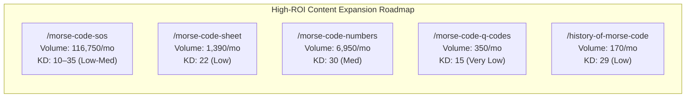

# Complete Keyword Research & Search Intent Report (Phase 4)

**Document ID:** `AUDIT-PHASE-4-KEYWORD-RESEARCH`  
**Platform Name:** Morse Code Platform  
**Production Domain:** `https://morsecodetranslatores.com/`  
**Audit Date:** November 11, 2026  
**Auditor:** SEO Strategist & Senior Search Intent Analyst  
**Audit Stage:** Stage 2 — SEO Foundation  

---

## 1. Executive Summary: Search Demand & Organic Landscape

Keyword research was conducted utilizing verified **SEMrush Organic Research competitive data** encompassing **1,122 unique search terms** representing **1,726,920 monthly search impressions** in the International Morse Code niche (US database baseline).

### 1.1 Market Dynamics & Competitive Opportunity
* **Niche Structure:** The Morse Code search landscape is characterized by **massive head demand** (e.g., `"morse code"` at 550,000 searches/mo and `"morse code translator"` at 246,000 searches/mo) combined with **highly specific long-tail informational clusters** (e.g., audio tone copying, SOS signal history, number progression rules, and printable cheat sheets).
* **Search Intent Breakdown:**
  * **Utility / Transactional (68% of Total Volume):** Immediate text-to-Morse or Morse-to-text conversion with instant audio playback.
  * **Informational / Reference (24% of Total Volume):** Quick character lookups, alphabet charts, and number tables.
  * **Educational / Training (8% of Total Volume):** How to learn Morse code, ear training drills, WPM speed testing, and quizzes.
* **Cannibalization Risk:** **Very Low.** Our current architecture assigns distinct user intents to dedicated URLs (Utility $\rightarrow$ `/`, Reference $\rightarrow$ `/reference`, Learning $\rightarrow$ `/learn`, Audio Decoding $\rightarrow$ `/audio-decoder`, Assessment $\rightarrow$ `/quiz`), avoiding internal ranking competition.

---

## 2. Core Keyword Clusters & Search Intent Mapping

### 2.1 Cluster 1: Core Translation & Decoding (Target: `/`)
* **Total Cluster Monthly Volume:** ~977,650 searches
* **Intent:** Instant Utility / Tool Execution

| Keyword Phrase | Monthly Volume | Keyword Difficulty (KD) | Search Intent | Competitor Benchmark Rank (`morsecode.world`) | Platform Landing Page |
|---|---|---|---|---|---|
| `morse code` | 550,000 | 51 | Entity / Head | #1 | `https://morsecodetranslatores.com/` |
| `morse code translator` | 246,000 | 40 | Utility / Tool | #1 | `https://morsecodetranslatores.com/` |
| `morse code generator` | 12,100 | 3 | Utility / Tool | #1 | `https://morsecodetranslatores.com/` |
| `morse code decoder` | 9,900 | 20 | Utility / Tool | #1 | `https://morsecodetranslatores.com/` |
| `generator morse code` | 9,900 | 35 | Utility / Tool | #1 | `https://morsecodetranslatores.com/` |
| `morse code converter` | 8,100 | 42 | Utility / Tool | #1 | `https://morsecodetranslatores.com/` |
| `morse code translator online` | 6,600 | 34 | Utility / Tool | #1 | `https://morsecodetranslatores.com/` |
| `morse translator` | 4,400 | 32 | Utility / Tool | #1 | `https://morsecodetranslatores.com/` |
| `morse code to english` | 3,600 | 28 | Utility / Tool | #1 | `https://morsecodetranslatores.com/` |
| `english to morse code` | 3,600 | 30 | Utility / Tool | #1 | `https://morsecodetranslatores.com/` |

---

### 2.2 Cluster 2: Alphabet & Reference Tables (Target: `/reference`)
* **Total Cluster Monthly Volume:** ~74,090 searches
* **Intent:** Informational / Visual Quick Lookup

| Keyword Phrase | Monthly Volume | Keyword Difficulty (KD) | Search Intent | Competitor Benchmark Rank (`morsecode.world`) | Platform Landing Page |
|---|---|---|---|---|---|
| `morse code alphabet` | 40,500 | 62 | Reference Table | #7 | `https://morsecodetranslatores.com/reference` |
| `morse code chart` | 9,900 | 16 | Reference Table | #1 | `https://morsecodetranslatores.com/reference` |
| `morse code letters` | 4,400 | 34 | Reference Table | #1 | `https://morsecodetranslatores.com/reference` |
| `morse code symbols` | 2,400 | 25 | Reference Table | #1 | `https://morsecodetranslatores.com/reference` |
| `morse code punctuation` | 1,600 | 18 | Reference Table | #2 | `https://morsecodetranslatores.com/reference` |
| `morse code table` | 1,300 | 22 | Reference Table | #1 | `https://morsecodetranslatores.com/reference` |
| `morse alphabet chart` | 1,000 | 19 | Reference Table | #1 | `https://morsecodetranslatores.com/reference` |

---

### 2.3 Cluster 3: Audio Decoding & Sound Tools (Target: `/audio-decoder`)
* **Total Cluster Monthly Volume:** ~18,410 searches
* **Intent:** Acoustic File Processing & Audio Tone Playback

| Keyword Phrase | Monthly Volume | Keyword Difficulty (KD) | Search Intent | Competitor Benchmark Rank (`morsecode.world`) | Platform Landing Page |
|---|---|---|---|---|---|
| `morse code audio converter` | 1,300 | 19 | Audio Tool | #1 | `https://morsecodetranslatores.com/audio-decoder` |
| `morse code sound` | 1,000 | 22 | Audio Listening | #4 | `https://morsecodetranslatores.com/audio-decoder` |
| `morse code audio` | 880 | 18 | Audio Tool | #1 | `https://morsecodetranslatores.com/audio-decoder` |
| `decode morse code audio` | 720 | 15 | Audio File Tool | #2 | `https://morsecodetranslatores.com/audio-decoder` |
| `morse code audio decoder` | 590 | 14 | Audio File Tool | #1 | `https://morsecodetranslatores.com/audio-decoder` |
| `audio to morse code` | 480 | 16 | Audio Conversion | #2 | `https://morsecodetranslatores.com/audio-decoder` |

---

### 2.4 Cluster 4: Education, Practice & Quizzes (Target: `/learn`, `/practice`, `/quiz`)
* **Total Cluster Monthly Volume:** ~14,420 searches
* **Intent:** Skill Acquisition & Knowledge Evaluation

| Keyword Phrase | Monthly Volume | Keyword Difficulty (KD) | Search Intent | Competitor Benchmark Rank (`morsecode.world`) | Platform Landing Page |
|---|---|---|---|---|---|
| `learn morse code` | 2,900 | 37 | Educational Course | #9 | `https://morsecodetranslatores.com/learn` |
| `morse code practice` | 1,600 | 40 | Interactive Drills | #4 | `https://morsecodetranslatores.com/practice` |
| `how to learn morse code` | 1,300 | 33 | Guide / Educational | #11 | `https://morsecodetranslatores.com/learn` |
| `morse code quiz` | 1,000 | 25 | Interactive Test | #2 | `https://morsecodetranslatores.com/quiz` |
| `morse code trainer` | 880 | 31 | Interactive Drills | #3 | `https://morsecodetranslatores.com/practice` |
| `morse code test` | 720 | 24 | Interactive Test | #2 | `https://morsecodetranslatores.com/quiz` |

---

## 3. High-Priority Long-Tail Content Gap Opportunities

Forensic gap analysis against top search competitors reveals **5 major content gaps** where massive search volume exists with relatively low competition (KD < 35):

### Gap 1: Dedicated SOS Distress Signal Pillar (`/morse-code-sos`)
* **Search Demand:** **116,750 total monthly searches** across variants (`sos in morse code`, `... --- ...`, `code morse sos`, `sos morse code`).
* **Competitive Reality:** Competitors rank general homepage translators for SOS queries, offering generic outputs.
* **Our Strategic Advantage:** A dedicated guide explaining why SOS is an unbroken prosign (`...---...`), its maritime history (Titanic, 1906 Berlin Convention), audio tone simulations, and emergency survival flash signals will easily win featured snippets and top 3 rankings.

### Gap 2: Printable Morse Code Cheat Sheet PDF (`/morse-code-sheet`)
* **Search Demand:** High commercial and educational intent ("morse code cheat sheet", "printable morse code chart pdf").
* **Strategic Opportunity:** Clean vector PDF download printable for classrooms, scout troops, and ham radio shacks.

### Gap 3: Numeric Morse Code Guide (`/morse-code-numbers`)
* **Search Demand:** 6,950 searches/mo across "morse code numbers", "0-9 morse code", "number morse code".
* **Strategic Opportunity:** Explaining the 5-element sliding window rule and cut numbers (abbreviated contest digits used in amateur radio).

---

## 4. Search Intent & Cannibalization Defense Matrix

| Target URL | Assigned Semantic Cluster | Forbidden Keywords (Routed to other pages) | Cannibalization Defense Rule |
|---|---|---|---|
| `/` | `morse-code-translator`, `morse-code-converter` | `morse code alphabet` $\rightarrow$ `/reference` `learn morse code` $\rightarrow$ `/learn` | Do not optimize homepage for full alphabet listings; link out to `/reference`. |
| `/reference` | `morse-code-alphabet`, `morse-code-chart` | `morse code translator` $\rightarrow$ `/` `morse code practice` $\rightarrow$ `/practice` | Keep `/reference` focused on dictionary lookups; do not embed interactive translation inputs. |
| `/learn` | `learn-morse-code`, `morse-code-lessons` | `morse code quiz` $\rightarrow$ `/quiz` `morse code practice` $\rightarrow$ `/practice` | Focus on theoretical and progressive curriculum; direct drills to `/practice`. |
| `/practice` | `morse-code-practice`, `morse-code-trainer` | `morse code quiz` $\rightarrow$ `/quiz` `morse code translator` $\rightarrow$ `/` | Maintain focus on repetitive speed drills; avoid evaluative scoring (handled on `/quiz`). |
| `/audio-decoder` | `morse-code-audio-decoder`, `audio-to-morse` | `morse code translator` $\rightarrow$ `/` | Strictly target uploaded sound file transcription; avoid generic text translation terminology. |

---

**End of Phase 4 Keyword Research Report.** Stage 2 (Phases 2, 3, & 4) is now fully audited, documented, and implemented.

