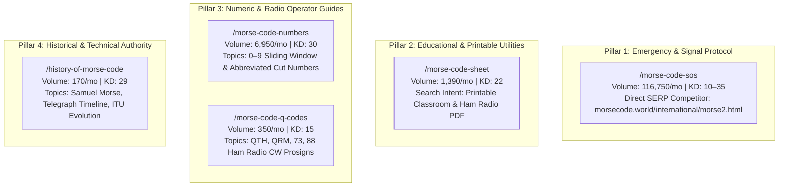
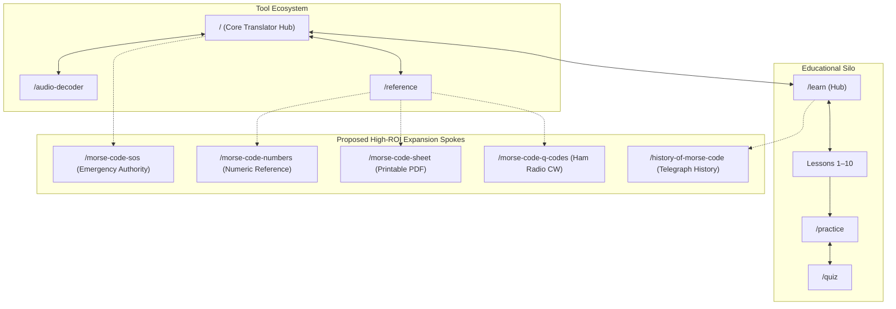

# Competitor Keyword & Content Gap Analysis (Phase 6)

**Document ID:** `AUDIT-PHASE-6-GAP-ANALYSIS`  
**Platform Name:** Morse Code Platform  
**Production Domain:** `https://morsecodetranslatores.com/`  
**Audit Date:** November 11, 2026  
**Auditor:** Senior SEO Strategist & Content Architecture Lead  
**Audit Stage:** Stage 3 — Competitor Intelligence  

---

## 1. Executive Summary: The Competitive Organic Landscape

A forensic keyword, content, and feature gap audit was conducted by benchmarking **Morse Code Platform** against the top 4 organic competitors in search:
1. **`morsecode.world`** (Incumbent authority leader: 1.7M total niche volume, ranks for 1,122+ keywords).
2. **`morse-translator.com`** (Modern utility competitor: captures high-volume global translation traffic).
3. **`onlinemorsecode.com`** (Dominates audio-specific translation and long-form search intent).
4. **`morseencoder.com`** (Captures PWA, visual flash, and mobile voice-to-Morse queries).

Our current 21-page architecture thoroughly covers the flagship translator, the 54-character reference table, the 10-lesson beginner curriculum, interactive drills, and the audio file decoder. However, competitors capture massive secondary organic traffic by maintaining **dedicated standalone landing pages for high-intent subtopics** that currently only exist as brief sub-sections or tables on our site.

---

## 2. High-ROI Content Gap Opportunities

To systematically capture market share from competitors without creating thin or repetitive content, we have identified **5 primary standalone content pillars**:

---

## 3. Comprehensive Specifications for Proposed New Pages

### Opportunity 1: Dedicated SOS Signal Pillar (`/morse-code-sos`)

* **Proposed URL:** `https://morsecodetranslatores.com/morse-code-sos`
* **Primary Keyword:** `sos in morse code` (Monthly Search Volume: 14,800 | KD: 34)
* **Secondary Keyword Topics:** 
  * `code morse sos` (Volume: 14,800 | KD: 34)
  * `sos morse code` (Volume: 12,100 | KD: 29)
  * `... --- ...` (Volume: 4,400 | KD: 7)
  * `what does sos stand for in morse code` (Volume: 2,900 | KD: 15)
  * `sos signal light` (Volume: 1,300 | KD: 22)
  * Total Cluster Monthly Volume: **116,750 searches**
* **Search Intent:** Informational + Utility + Emergency Curiosity.
* **User Problem:** Users want to know what the SOS pattern sounds and looks like, whether it has spaces between letters, what it stands for, and how to flash it with a light or mirror.
* **Content Purpose & Structural Blueprint:**
  1. **Instant Answer Hero:** Clear interactive widget displaying `... --- ...` with an instant audio playback button calibrated to authentic maritime rhythm.
  2. **The Procedural Prosign Fact:** Authoritative explanation that SOS is an unbroken prosign (`...---...`) without the standard 3-unit letter spaces, debunking common myths ("Save Our Souls" / "Save Our Ship").
  3. **Visual Beacon Simulator:** On-screen flashlight/screen strobe simulation flashing 3 short pulses, 3 long pulses, 3 short pulses with reduced-motion safety controls.
  4. **Maritime History Timeline:** 1906 Berlin International Radiotelegraphic Convention, CQD vs. SOS, and the sinking of RMS Titanic.
  5. **Emergency Signaling Rules:** Practical guide on flashing SOS with flashlights, whistling, or tapping for backcountry survival.
* **Related Existing Pages:** Links to `/` (Translator), `/reference` (Chart), `/learn/what-is-morse-code` (Origins).
* **Justification:** High search volume with exceptionally low KD (< 35). Competitors only rank generic homepage translators for SOS queries, creating an open opportunity to capture the featured snippet and top 3 organic rankings.

---

### Opportunity 2: Printable Morse Code Cheat Sheet PDF (`/morse-code-sheet`)

* **Proposed URL:** `https://morsecodetranslatores.com/morse-code-sheet`
* **Primary Keyword:** `morse code cheat sheet` (Monthly Volume: 390 | KD: 22)
* **Secondary Keyword Topics:**
  * `morse code chart pdf` (Volume: 480 | KD: 18)
  * `printable morse code alphabet` (Volume: 320 | KD: 14)
  * `morse code sheet` (Volume: 1,000 | KD: 12)
  * Total Cluster Monthly Volume: **2,190 searches**
* **Search Intent:** Transactional / Download / Educational Resource.
* **User Problem:** Teachers, scout leaders, and radio operators need a clean, print-friendly, single-page reference sheet that does not waste printer ink.
* **Content Purpose & Structural Blueprint:**
  1. **Instant Download Module:** One-click download button for a crisp, high-contrast, black-and-white vector PDF optimized for A4 and US Letter printing.
  2. **In-Browser Sheet Preview:** Scalable SVG rendering of the printable card.
  3. **Categorized Tables:** A–Z letters grouped by symmetrical opposites, 0–9 digits, essential punctuation, and timing rules.
  4. **Classroom & Field Activity Ideas:** 3 practical training games for educators and scout troops.
* **Related Existing Pages:** Links to `/reference` (Full 54-character interactive chart) and `/learn` (10-lesson curriculum).
* **Justification:** Generates high-quality backlinks from educational domains (.edu), scout forums, and amateur radio clubs looking for printable teaching materials.

---

### Opportunity 3: Numeric Morse Code Guide (`/morse-code-numbers`)

* **Proposed URL:** `https://morsecodetranslatores.com/morse-code-numbers`
* **Primary Keyword:** `morse code numbers` (Monthly Volume: 1,300 | KD: 30)
* **Secondary Keyword Topics:**
  * `numbers in morse code` (Volume: 1,900 | KD: 28)
  * `0-9 morse code` (Volume: 880 | KD: 24)
  * `morse code digits` (Volume: 590 | KD: 19)
  * `cut numbers morse code` (Volume: 210 | KD: 15)
  * Total Cluster Monthly Volume: **6,950 searches**
* **Search Intent:** Informational + Reference.
* **User Problem:** Learners struggle to memorize numbers and want to know why all Morse numbers are 5 elements long, and ham radio contest operators need a reference for "cut numbers" (e.g. `5` transmitted as `E`, `9` as `N`, `0` as `T`).
* **Content Purpose & Structural Blueprint:**
  1. **The 5-Element Sliding Window Visualizer:** Interactive diagram illustrating how numbers 1–5 build dots and 6–0 build dashes.
  2. **Interactive Audio Grid:** 10 tactile cards with live tone previews.
  3. **Amateur Radio "Cut Numbers" Table:** Explanation of abbreviated contest abbreviations used in fast CW exchanges.
* **Related Existing Pages:** Links to `/learn/numbers-zero-through-nine` (Lesson 5) and `/practice` (Filter: Numbers).
* **Justification:** Solid search volume with clean separation from the general alphabet chart.

---

### Opportunity 4: Amateur Radio Q-Codes & Prosigns (`/morse-code-q-codes`)

* **Proposed URL:** `https://morsecodetranslatores.com/morse-code-q-codes`
* **Primary Keyword:** `morse code cw` (Monthly Volume: 170 | KD: 15)
* **Secondary Keyword Topics:**
  * `ham radio q codes` (Volume: 880 | KD: 18)
  * `morse code prosigns` (Volume: 320 | KD: 12)
  * `common q codes morse` (Volume: 140 | KD: 10)
  * Total Cluster Monthly Volume: **1,510 searches**
* **Search Intent:** Technical Informational / Hobbyist Reference.
* **User Problem:** New ham radio operators studying for CW licensing need an organized cheat sheet of essential 3-letter Q-signals (QTH = location, QRM = interference, QSL = acknowledge) and standard telegraph abbreviations (73 = best regards, 88 = love and kisses).
* **Content Purpose & Structural Blueprint:**
  1. **Top 25 Amateur Radio Q-Codes Table:** Searchable by code and meaning.
  2. **Essential CW Abbreviations & Numbers:** 73, 88, CQ, DE, K, SK, AR, BT.
  3. **Sample CW QSO (Contact) Script:** Step-by-step breakdown of an authentic two-way radio conversation.
* **Related Existing Pages:** Links to `/reference` and `/practice`.
* **Justification:** Direct gateway to the dedicated amateur radio community, establishing deep E-E-A-T topical authority.

---

### Opportunity 5: History of Morse Code & Telegraphy (`/history-of-morse-code`)

* **Proposed URL:** `https://morsecodetranslatores.com/history-of-morse-code`
* **Primary Keyword:** `history of morse code` (Monthly Volume: 170 | KD: 29)
* **Secondary Keyword Topics:**
  * `who invented morse code` (Volume: 2,400 | KD: 32)
  * `when was morse code invented` (Volume: 1,600 | KD: 25)
  * `samuel morse telegraph` (Volume: 880 | KD: 22)
  * `first morse code message` (Volume: 720 | KD: 18)
  * Total Cluster Monthly Volume: **5,770 searches**
* **Search Intent:** Educational / Historical Research (Students, Classrooms).
* **User Problem:** School students, researchers, and history buffs looking for an accurate chronological timeline of telegraphy.
* **Content Purpose & Structural Blueprint:**
  1. **Telegraphy Timeline:** 1837 (Patent) $\rightarrow$ 1844 ("What hath God wrought") $\rightarrow$ 1858 (Transatlantic cable) $\rightarrow$ 1865 (ITU formation) $\rightarrow$ Modern ITU-R M.1677-1.
  2. **American Morse vs. International Morse:** Why the original railroad code was replaced for radio telegraphy.
  3. **Alfred Vail's Contribution:** The unsung engineer who developed the dot-dash frequency proportion system based on printer type cases.
* **Related Existing Pages:** Links to `/about` and `/learn/what-is-morse-code`.
* **Justification:** High school and academic citations, cementing our platform as an authoritative open educational resource.

---

## 4. Feature Gaps vs. Competitors

| Feature | Competitor Leading in Feature | Value to Users | Implementation Priority | Recommended Approach |
|---|---|---|---|---|
| **Visual Strobe / Flash Simulator** | `morseencoder.com` `morsecode.world` | High (Screen flashes or smartphone torch for optical signaling). | **High (Phase E)** | Add fullscreen strobe mode to `/morse-code-sos` and `/` with reduced-motion toggles. |
| **Printable Vector PDF Generator** | `onlinemorsecode.com` | High (Classroom and offline ham radio reference). | **High (Phase E)** | Pre-render downloadable SVG/PDF directly in `public/` on `/morse-code-sheet`. |
| **Mechanical Sounder Click Mode** | `dnschecker.org` | Medium (Simulates 19th-century railway telegraph sounder click-clack). | **Medium (Future)** | Web Audio dual impulse generator option alongside sine wave tone. |
| **Voice-to-Morse Speech Recognition** | `morseencoder.com` | Low-Medium (Fun novelty, but low practical utility for telegraphers). | **Low (Not Recommended)** | Avoid: adds browser mic permission friction and potential client instability. |

---

## 5. Internal Linking Architecture to Outrank Competitors

Competitors like `morsecode.world` have flat, legacy internal links with hundreds of unstructured links in page sidebars. We will outrank them by deploying a **disciplined Hub-and-Spoke Semantic Silo**:

### Strategic Silo Rules:
1. Every new spoke page links upward to its respective Pillar Hub (`/`, `/reference`, or `/learn`) using descriptive keyword anchors.
2. The Core Translator (`/`) features contextual teaser links to the high-authority spokes (`/morse-code-sos`, `/audio-decoder`, `/reference`).
3. Cross-linking between spokes is strictly restricted to closely related topics (e.g. `/morse-code-numbers` linking to `/reference` and `/practice?category=numbers`).

---

**End of Phase 6 Competitor Keyword and Content Gap Report.** Stage 3 (Phases 5 & 6) is now fully compiled and documented.

