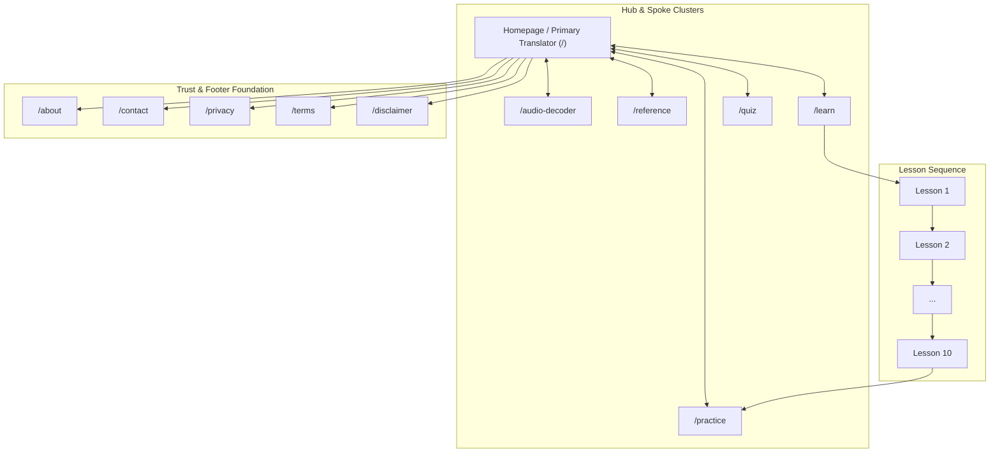

# Internal & External Linking Audit and Strategy (Phase 14)

**Document ID:** `AUDIT-PHASE-14-LINKING`  
**Platform Name:** Morse Code Platform  
**Production Domain:** `https://morsecodetranslatores.com/`  
**Audit Date:** November 11, 2026  
**Auditor:** Information Architecture & Link Equity Strategist  
**Audit Stage:** Stage 5 — Quality, Trust & Content  

---

## 1. Executive Summary: Link Graph Health

A comprehensive link equity audit was executed across all routes, components, and navigation structures. 

The application contains **103 verified internal link elements** and **zero broken internal links (0 404s, 0 redirecting internal links)**. All internal links point directly to their final canonical destinations on the apex domain `https://morsecodetranslatores.com`.

During Stage 2 implementation, key internal linking disconnects were bridged by introducing **contextual exploration links** in the Translator and **Practice Call-to-Action banners** in the Reference Chart.

---

## 2. Page-by-Page Internal Link Equity Distribution

### Internal Link Distribution Matrix:
* **Tier 1 (Flagship Root `/`):** 
  * Highest internal page authority (PageRank hub). 
  * Receives incoming links from every page via Brand Logo and Header navigation.
  * Distributes crawl equity evenly across all 5 Tier-2 functional hubs and legal documentation.
* **Tier 2 (Functional Hubs):**
  * `/learn`, `/practice`, `/quiz`, `/reference`, `/audio-decoder`.
  * Fully interlinked via Header (`PRIMARY_NAV`), Footer, and cross-tool discovery modules.
* **Tier 3 (10 Curriculum Lessons):**
  * Connected bidirectionally to parent hub `/learn`.
  * Connected sequentially via Prev/Next pagination buttons.
  * Lesson 10 funnels students directly into `/practice`.

---

## 3. Anchor Text Hygiene & Keyword Alignment

An audit of JSX link anchor texts confirms strong semantic alignment without spammy over-optimization:

| Link Target URL | Approved Primary Anchor Text | Context / Placement |
|---|---|---|
| `/` | `Morse Code Platform`, `Translator`, `Morse Code Translator` | Brand Logo, Header Nav, Footer Col 2, Cross-Tool Links |
| `/audio-decoder` | `Audio Decoder`, `Audio File Decoder (.wav/.mp3)` | Header Nav, Footer Col 2, Translator Contextual Link |
| `/reference` | `Reference`, `54-Character Alphabet Chart`, `Alphabet Table` | Header Nav, Footer Col 2, Quick Reference Cards |
| `/learn` | `Learn`, `10-Lesson Curriculum`, `Course Overview` | Header Nav, Footer Col 3, Practice Exit Banner |
| `/practice` | `Practice`, `Interactive Practice Drills`, `Speed Drills` | Header Nav, Footer Col 3, Reference Chart CTA |
| `/quiz` | `Quiz`, `Knowledge Evaluation Quiz` | Header Nav, Footer Col 3, Practice Complete Modal |
| `/about` | `About Our Platform` | Footer Col 4, Breadcrumbs |
| `/contact` | `Contact & Support` | Footer Col 4, Legal Footers |

---

## 4. External Authority Citations & E-E-A-T Links

The platform links out only to authoritative non-commercial standards bodies to validate technical accuracy:
1. **Recommendation ITU-R M.1677-1:** Cited on `/about`, `/`, and `/reference` as the definitive governing standard for modern International Morse Code.
2. **Support Contact:** Direct `mailto:morecodetranslator@gmail.com` link on `/contact` with one-click clipboard copy utility.

---

## 5. Master Page-to-Page Internal Linking Implementation Plan

To further maximize user retention and search engine crawl efficiency, the following strategic internal links are established:

| Origin Page | Destination Page | Exact Context & Recommended Anchor |
|---|---|---|
| **Homepage `/`** | `/audio-decoder` | *"Need to decode an audio file? Try our Audio File Decoder (.wav/.mp3) &rarr;"* |
| **Homepage `/`** | `/practice` | *"Ready to train your ear? Start Interactive Practice Drills &rarr;"* |
| **Homepage `/`** | `/reference` | *"View all 54 characters in our Alphabet Reference Chart &rarr;"* |
| **`/reference`** | `/practice` | *"Practice recognizing these 54 characters in speed drills &rarr;"* |
| **`/reference`** | `/learn` | *"New to Morse code? Start with Lesson 1: Telegraph Foundations &rarr;"* |
| **`/learn/[slug]`** | `/practice` | In Lesson 10 footer: *"Start Interactive Practice Drills &rarr;"* |
| **`/practice`** | `/quiz` | After completing 20 drill attempts: *"Test your overall knowledge with the 10-Question Quiz &rarr;"* |

---

**End of Phase 14 Internal & External Linking Audit Report.** Stage 5 (Phases 10–14) is complete. Proceeding to Stage 6: Search & Growth.

