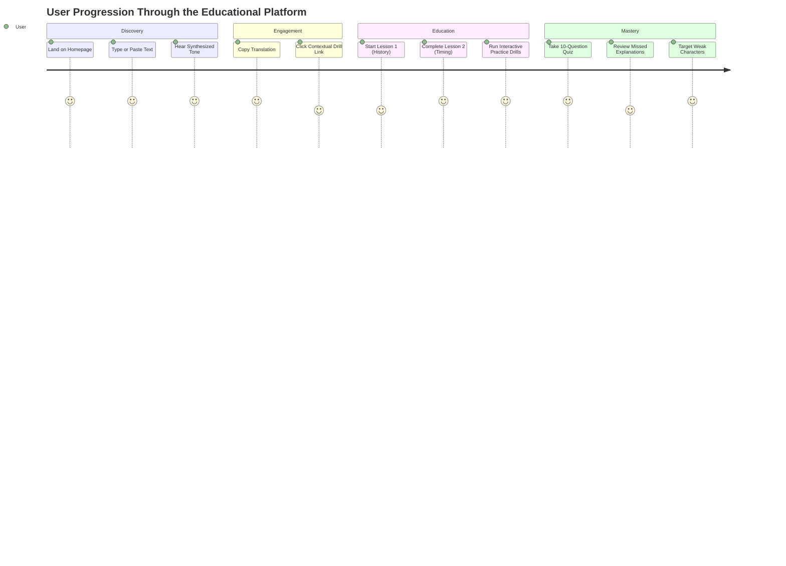

# User Journey and Engagement (CRO) Audit Report (Phase 16)

**Document ID:** `AUDIT-PHASE-16-USER-JOURNEY-CRO`  
**Platform Name:** Morse Code Platform  
**Production Domain:** `https://morsecodetranslatores.com/`  
**Audit Date:** November 11, 2026  
**Auditor:** Conversion Rate Optimization (CRO) & User Experience Strategist  
**Audit Stage:** Stage 6 — Search & Growth  

---

## 1. Executive Summary: The Free Platform Engagement Model

Because the **Morse Code Platform** is a 100% free educational and utility service without subscriptions, paywalls, or accounts, **"Conversion" is defined not as monetary checkout, but as high-value user engagement, task completion, and educational retention**:

* **Utility Conversions:** Instant translation completion, audio tone playback, and client-side WAV export download.
* **Educational Conversions:** Completing interactive lesson exercises, finishing a 10-question quiz, and completing a 20-card practice drill.
* **Retention Conversions:** Bookmark saves, repeated return visits for practice, and cross-tool exploration.

---

## 2. The First 5 Seconds & Frictionless Onboarding

1. **Immediate Tool Access (Zero Friction):**
   * The primary translation interface is visible immediately on viewport load without requiring scrolling.
   * **Zero Popups / Zero Overlays:** Unlike competitors, there are **no newsletter popups, no signup modals, no intrusive cookie acceptance bars, and no third-party banner ads** obstructing the workbench.
2. **Instant Visual Feedback:**
   * Live character and word counters (`dotCount`, `dashCount`, `wordCount`) update dynamically with every keystroke.
   * Telemetry badges clearly state: *"Recommendation ITU-R M.1677-1 Standard &bull; Free &amp; Private"*.

---

## 3. User Journey Analysis Across Core Personas

---

## 4. Call-to-Action (CTA) Hierarchy & Placement

| Page Type | Primary Call-to-Action (CTA) | Secondary CTA | Placement & Psychological Hook |
|---|---|---|---|
| **Homepage `/`** | "Play Audio" & "Copy" buttons | "Explore Further: Audio Decoder &bull; Practice &bull; Reference" | Directly below output box; transitions utility visitors into learning loops. |
| **Tool `/audio-decoder`** | "Upload Audio File" dropzone | "Clear" & "Copy Decoded Text" | Centered top card; encourages immediate drag-and-drop file testing. |
| **Reference `/reference`** | Character search input | "Start Practice Drills &rarr;" banner | Top filter bar + bottom retention CTA banner below the table. |
| **Curriculum `/learn`** | "Start Lesson 1: Foundations &rarr;" | "Practice Drills" & "Knowledge Quiz" | Prominent top hero action card with estimated completion times. |
| **Lessons `/learn/[slug]`** | "Check Answer" interactive exercise card | "Next Lesson &rarr;" / "Start Practice Drills" | Bottom of lesson body; provides immediate reinforcement before advancing. |
| **Practice `/practice`** | "Submit Answer" tactile touch button | "Weak Focus" filter toggle | Centered drill card; gamifies error correction. |
| **Quiz `/quiz`** | "Check Answer" & "See Final Results" | "Retake Quiz" & "Review Missed Topics" | End of 10-question evaluation; drives targeted review. |

---

## 5. CRO Recommendations to Maximize Returning Traffic

1. **Daily Practice Streak Gamification:**
   * Store consecutive days practiced in `localStorage` and display a small, non-intrusive flame badge (`🔥 3 Day Streak`) on the header to build habitual learning routines.
2. **"Share Translated Link" Prominence:**
   * The existing `Translator.tsx` component supports URL parameters (`?text=...`). Adding a prominent "Share Encoded Message" button allows users to send secret Morse messages to friends, creating organic viral loop referrals.

---

**End of Phase 16 User Journey & CRO Report.** Proceeding to Phase 17: AEO & AI Search Optimization.

